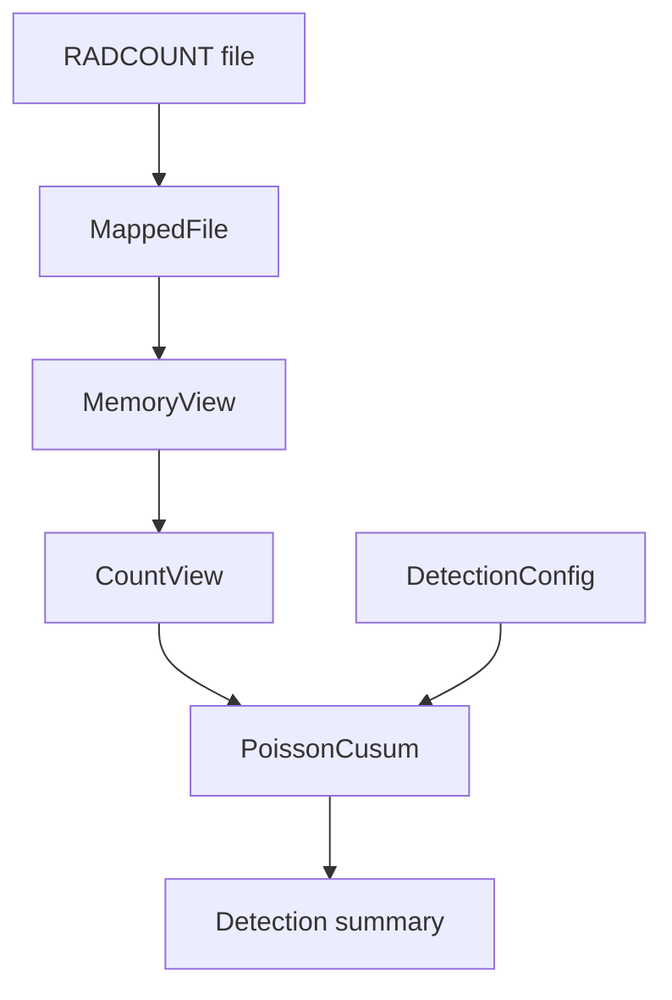

# RadShift

A C++20 Poisson CUSUM detector for identifying persistent increases in
count-rate measurements.

RadShift reads a compact binary trace through a read-only memory mapping
and processes observations sequentially. Its architecture separates file
ownership, binary-format validation, and statistical detection.

## Motivation

Count-based sensors produce noisy integer observations. A single high count
may be a random fluctuation rather than a persistent change.

RadShift accumulates statistical evidence across observations to detect an
increase from a specified baseline rate to a specified alternative rate.

The project combines sequential statistics with explicit resource ownership
and validated binary input.

## Current capabilities

- Read-only POSIX memory mapping.
- RAII management of file descriptors and mappings.
- Shared-lifetime memory views.
- Validation of the RADCOUNT binary format.
- Little-endian integer decoding.
- Poisson CUSUM processing without per-bin allocation.
- First-alarm reporting with zero-based bin indices.
- Command-line configuration of rates and threshold.
- Automated storage and detector tests through CTest.

This version supports macOS/Linux APIs and completed input files that remain
unchanged during processing.

## Architecture



| Component | Responsibility |
|---|---|
| `MappingResource` | Owns the mapping and releases it through RAII |
| `MappedFile` | Opens and maps a regular file |
| `MemoryView` | Keeps shared ownership of the mapping |
| `CountView` | Validates the file and decodes counts |
| `DetectionConfig` | Validates rates and alarm threshold |
| `PoissonCusum` | Processes counts and records the first alarm |

`CountView` remains usable after the original `MappedFile` is destroyed
because its `MemoryView` retains shared ownership of the mapping.

Shared ownership protects mapping lifetime. It does not protect against
external modification or truncation of the input file.

## Statistical model

For a bin duration Δt and count rate r:

    K_t ~ Poisson(r × Δt)

The detector compares:

- Baseline rate: r₀
- Alternative rate: r₁ > r₀

The per-bin log-likelihood contribution is:

    ℓ_t = K_t × log(r₁ / r₀) − (r₁ − r₀) × Δt

The CUSUM update is:

    S_t = max(0, S_(t−1) + ℓ_t)

The first bin satisfying `S_t >= threshold` is recorded as the alarm.

Rates are expressed in counts/second. Bin duration is stored in the file
as integer nanoseconds.

## Requirements

- C++20 compiler
- CMake 3.20 or newer
- macOS or Linux
- Python 3 for generating the example fixture

The C++ implementation requires no third-party libraries.

## Build

Run from the repository root:

```bash
cmake -S . -B build-cmake \
  -DCMAKE_BUILD_TYPE=Debug \
  -DBUILD_TESTING=ON

cmake --build build-cmake --parallel
```

## Run the tests

```bash
ctest --test-dir build-cmake --output-on-failure
```

The tests cover:

- Known CUSUM scores and first-alarm position.
- Zero-count observations.
- Alarm at bin zero.
- Invalid detection parameters.
- Binary-format validation.
- Little-endian decoding.
- Out-of-range count access.
- Mapping lifetime after destruction of the original file owner.

## Reproducible example

Generate a four-bin trace:

```bash
python3 scripts/create_fixture.py
```

The trace contains:

```text
Counts:       [0, 1, 2, 6]
Bin duration: 1 second
File size:    48 bytes
```

Run detection:

```bash
./build-cmake/radshift examples/four_bins.rct 1 3 4
```

Argument order:

```text
radshift <trace.rct> <baseline_rate> <alternative_rate> <threshold>
```

Expected output:

```text
Baseline rate: 1.000000 counts/s
Alternative rate: 3.000000 counts/s
Threshold: 4.000000
Bins: 4
Bin duration (ns): 1000000000
Final CUSUM score: 4.788898
First alarm bin: 3
```

Increasing the threshold prevents an alarm for this short trace:

```bash
./build-cmake/radshift examples/four_bins.rct 1 3 10
```

Expected final line:

```text
No alarm
```

## Binary format: RADCOUNT v1

All integer fields use little-endian encoding.

| Offset | Size | Field |
|---:|---:|---|
| 0 | 8 bytes | ASCII magic: `RADCOUNT` |
| 8 | 4 bytes | Version: `1` |
| 12 | 4 bytes | Header size: `32` |
| 16 | 8 bytes | Number of bins |
| 24 | 8 bytes | Bin duration in nanoseconds |
| 32 | 4 bytes per bin | Unsigned 32-bit counts |

The parser rejects unsupported headers, zero duration, zero bins, and
payload sizes inconsistent with the declared count.

## Performance design

- No complete application-owned copy of the mapped input.
- Constant detector-state memory.
- Precomputed likelihood coefficients.
- No allocation or text parsing inside the detector update.
- Summary output after processing.

Memory mapping is not assumed to outperform buffered reading.
Comparative benchmarks are planned; no throughput claims are made yet.

A whole-file mapping uses virtual address space proportional to file size.
Resident memory depends on accessed pages and operating-system behavior.

## Limitations

- Upward changes only.
- Known, fixed baseline and alternative rates.
- Fixed-duration bins.
- Poisson observation model.
- Thresholds are user-specified and have not been statistically calibrated.
- First-alarm detection; processing continues after the alarm.
- No live acquisition or growing-file support.
- No medical, dosimetry, or safety certification.

## Roadmap

- Synthetic Poisson trace generator.
- False-alarm and detection-delay evaluation.
- Buffered binary reader.
- Mapped-versus-buffered benchmarks.
- Automated command-line tests.
- Threshold calibration.
- CSV result export.

## Author

Nickolas Adrian Papamichail
